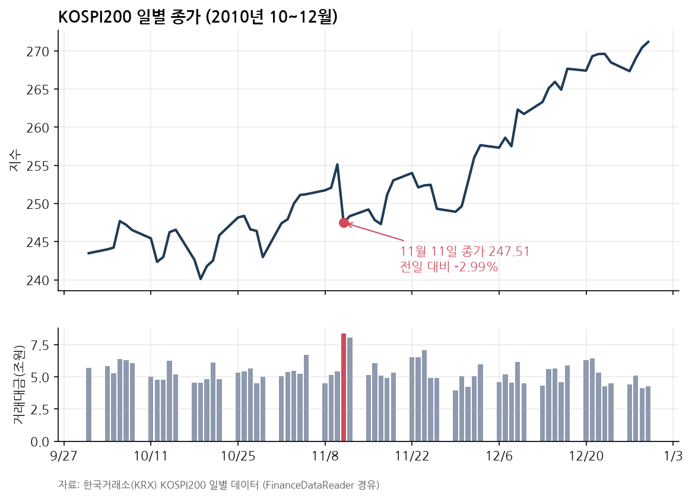
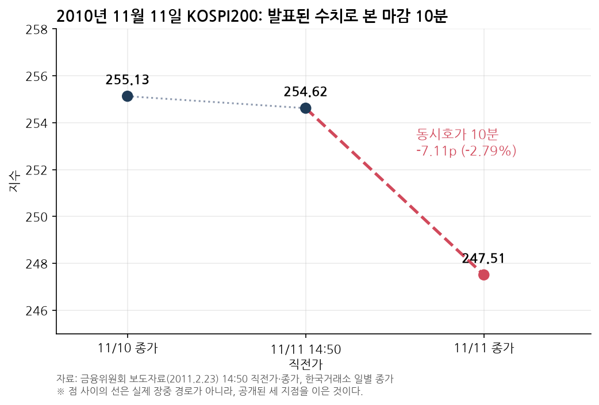
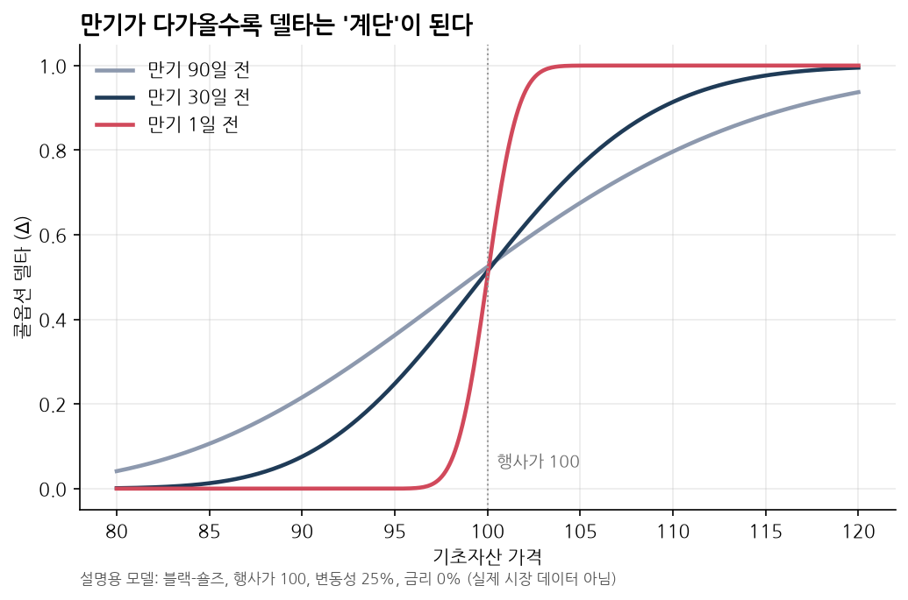
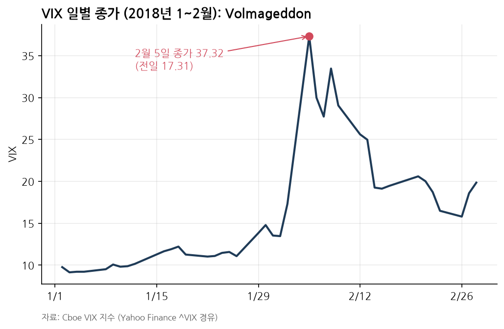

2010년 11월 11일 KOSPI200 옵션 만기일 오후 2시 50분까지 시장은 조용했다. 254.86으로 출발한 지수는 장중 256.51까지 올랐고, 동시호가 진입 직전가는 254.62(전일 종가 255.13)였다.

마지막 10분 동안 상황이 돌변했다. 도이치증권 창구에서 삼성전자를 포함한 199개 종목, **2조 4,424억원** 규모의 매도 주문이 7차례에 걸쳐 쏟아졌다. 호가는 전부 직전 체결가보다 4.5~10% 낮게 찍혀 있었다. 결과적으로 KOSPI200은 10분 만에 254.62에서 247.51(-7.11p, -2.79% / 전일 대비 -2.99%)로 당일 최저가에 마감했고, 코스피는 1,967.85에서 1,914.73(-53.12p)으로 밀렸다. 이날 KOSPI200 거래대금은 전날(약 5.41조원)보다 급증한 약 8.36조원이었다.

_2010년 10~12월 KOSPI200 일별 종가와 거래대금(한국거래소). 11월 11일 하루만 지수가 꺾이고 거래대금이 튀었다._

일봉 차트를 길게 놓고 보면 11월 11일 하루만 푹 꺼졌다가 바로 기존 추세로 복귀한다. 거시 변수나 기업 실적 변화 없이, 그 10분 동안은 만기 청산 수급만으로 가격이 형성됐다.

_전일 종가(255.13), 14:50 직전가(254.62), 11일 종가(247.51)를 이은 흐름._

## 2조 4천억원의 출처: 지수차익거래와 베이시스

[금융위원회 조사 결과(2011.2.23)](https://www.fsc.go.kr/eng/pr010101/21944)에 따르면 이날 쏟아진 현물 바스켓은 도이치가 2010년 한 해 동안 지수차익거래로 사 모은 물량이었다.

지수선물의 이론가격은 현물지수 $S$, 금리 $r$, 배당수익률 $q$, 잔존만기 $T$에 대해 대략 다음과 같다.

$$
F = S \cdot e^{(r-q)T}
$$

실제 선물가격이 이론가보다 비싸면 베이시스($F - S$)가 확대되고, 차익거래자는 선물을 파는 동시에 현물 바스켓을 매수(매수차익거래)한다. 지수가 오르면 현물 이익이 선물 손실을 상쇄하고, 내리면 반대로 상쇄된다. 선물 대신 콜옵션 매도와 풋옵션 매수를 묶어도 선물 매도와 동일한 손익을 내는 합성선물 매도가 된다. 도이치가 활용한 것도 이 합성선물이었다.

KOSPI200 선물·옵션의 최종 정산 기준은 **만기일 KOSPI200 종가**다. 만기 종가 시점에는 선물과 현물의 가격 차이인 베이시스가 0으로 수렴한다. 따라서 차익거래자가 다음 만기로 롤오버하지 않고 포지션을 접으려면, 정확히 만기일 동시호가 종가에 현물을 던져야 처음 계산한 차익이 오차 없이 확정된다. 만기일 동시호가에 현물 청산 물량이 집중되는 구조적 이유다.

## 델타와 감마가 만드는 집중 청산

방향성을 중립으로 맞춘 차익 포지션을 파생상품의 델타($\Delta = \frac{\partial V}{\partial S}$, 기초자산이 1단위 움직일 때 포지션 가치의 변화)로 표기하면 구조가 한눈에 들어온다.

| 포지션 | 델타 | 지수 상승 시 |
|---|---:|---|
| 현물 바스켓 매수 | +1 | 이익 |
| 선물 또는 합성선물 매도 | -1 | 손실 |
| 차익거래 합계 | ≈ 0 | 방향성 중립 |
| 풋옵션 매수 | -1 ~ 0 | 손실 (하락 시 이익) |

옵션이 낀 포지션에서 델타를 0 근처로 유지하는 작업을 델타헤지라고 부른다. 문제는 델타가 고정된 숫자가 아니라 기초자산 가격에 따라 계속 변하고, 그 변화 속도인 감마($\Gamma$)가 만기 직전 행사가 부근에서 급격히 커진다는 점이다.

_블랙-숄즈 모형(행사가 100, 변동성 25%, 금리 0%) 기준 만기 90일·30일·1일 전 콜옵션 델타._

만기 90일 전에는 완만하던 델타 곡선이 만기 하루 전에는 행사가 근처에서 거의 계단 형태가 된다. 기초자산이 1~2%만 움직여도 델타가 0에서 1로 뒤집히니, 만기일에는 쌓인 헤지나 차익 물량을 한꺼번에 줄이거나 청산하는 **델타 언와인딩**이 발생할 수밖에 없다.

이 청산 물량이 실제 시장 가격을 꺾어 내리는 조건은 네 가지다.

1. 최종 정산 가격이 종가 단일가라 물량이 오후 2시 50분 이후 10분에 집중된다.
2. 10분 동안 2조원대 매도를 받아 줄 반대편 유동성에는 한계가 있어 호가가 여러 단계 밀린다.
3. 단일가매매는 주문을 모아 하나의 균형가격으로 체결하기 때문에, 마감 직전 4.5~10% 낮은 가격의 대량 매도가 들어오면 예상 체결가 전체가 끌려 내려간다.
4. 청산 시점과 방향이 노출되면 다른 참가자들이 먼저 움직여 변동폭을 키운다.

당시 한국거래소에는 만기일 프로그램 매매를 장 종료 15분 전(오후 2시 45분)까지 사전 신고하도록 하는 제도가 있었다. 시장에 대비할 시간을 주자는 취지였지만, [자본시장연구원 분석](https://www.kcmi.re.kr/kcmifile/oldfiledata/weekly_1_33_646.pdf)이 짚었듯 역설적인 허점이 있었다. 2시 45분 이후 대규모 매도 불균형이 확인돼도 다른 회원사는 신고한 대로만 호가를 제출해야 했기 때문에, 막판 매물 폭탄에 대응할 반대 매수가 들어올 통로가 막혀 있었다.

## 정상 청산과 연계 시세조종의 경계

만기일 종가에 차익 바스켓을 대량 매도하는 행위 자체는 위법이 아니다. 장부의 델타가 0으로 맞춰진 정상 청산이라면 현물을 싸게 팔아 손해를 보더라도 선물·합성선물 매도 쪽 이익으로 그대로 메워지므로, 굳이 종가를 끌어내릴 유인이 없다.

금융당국이 [검찰 고발(2011.2.23)](https://www.yna.co.kr/view/AKR20110223225800008)에서 문제 삼은 핵심은 **청산 직전 장부 델타를 의도적으로 기울인 순서**였다.

1. 동시호가 진입 직전 30분(14:19:50~14:49:59) 동안, 기존 차익 포지션을 넘어서는 합성선물 매도와 풋옵션 매수를 새로 얹어 델타가 0이던 장부를 음(-)의 델타로 돌려놓았다.
2. 14시 50분 동시호가에서 2조 4,424억원 현물 바스켓을 직전가 대비 4.5~10% 낮게 일괄 투매했다.
3. 지수가 2.79% 빠지면서 미리 쌓아 둔 풋옵션에서 **448억 7천만원**의 이익이 났다.

헤지 포지션을 푸는 것 자체는 위험관리지만, 풀기 직전에 하락 방향 베팅을 먼저 얹고 현물 투매로 종가를 눌러 파생에서 이익을 챙기는 순간 현물·파생 연계 시세조종이 된다.

## 제재, 13년의 재판, 그리고 반대편 손실

사건 다음 날(2010.11.12) 금감원과 거래소가 공동조사에 들어갔고, 2011년 2월 금융위는 도이치은행 홍콩지점 임직원 등 5명과 한국도이치증권을 검찰에 고발하고 한국도이치증권에 6개월 일부 영업정지(2011.4.1~9.30)를 내렸다.

형사재판과 민사재판의 결론은 엇갈렸다. 형사에서는 2016년 1월 1심이 한국도이치증권 박모 상무에게 징역 5년, 법인에 벌금 15억원을 선고했지만, [2018년 12월 항소심](https://www.yna.co.kr/view/AKR20181212105700004)은 공모 증거 부족을 이유로 무죄를 선고했고 [2023년 12월 대법원](https://www.yna.co.kr/view/AKR20240116147400004)에서 무죄가 확정됐다. 주범으로 지목돼 2011년 8월 기소된 홍콩지점 외국인 임원 3명은 끝내 국내 법정에 출석하지 않아 2024년 1월 보도 기준으로 인터폴 수배 상태이며, 2036년 8월까지 유죄가 확정되지 않으면 처벌할 수 없게 된다. 반면 민사에서는 [2015년 11월 서울중앙지법](https://www.hani.co.kr/arti/society/society_general/719191.html)이 손해배상 책임을 처음 인정했고 피해 금융사 5곳에 피해액의 80%인 280억원을 배상하는 화해권고가 확정됐으며, [2018년 9월 대법원](https://www.law.go.kr/LSW/precInfoP.do?precSeq=205730)도 개인투자자 청구권의 소멸시효가 남았다고 판단했다.

한편 이날 반대편에서 감마 리스크를 그대로 맞은 곳도 나왔다. 콜과 풋을 동시에 파는 양매도(음의 감마) 전략을 쓰던 [와이즈에셋자산운용](https://www.mk.co.kr/news/stock/4805090) 사모파생펀드는 하루에 **899억원**을 잃었고, 결제를 맡은 하나대투증권이 약 760억원을 대납했다. 와이즈에셋은 결국 [2012년 8월 금융투자업 인가가 취소](https://news.einfomax.co.kr/news/articleView.html?idxno=32170)되며 자본시장법 시행 후 운용사 첫 퇴출 사례가 됐다. 한쪽이 대규모 언와인딩을 일으키면 변동성 매도 포지션을 쥔 반대편이 고스란히 손실을 떠안게 된다.

이후 한국거래소는 2011년 5월 30일부터 재발 방지책을 시행했다.

| 제도 | 2010년 당시 | 2011.5.30 개정 이후 |
|---|---|---|
| [프로그램 호가 공시](https://www.mk.co.kr/news/stock/4850674) | 14:45까지 신고한 대로만 호가 제출 | 매수·매도 불균형 기준(차이 비율 75% 초과, 차액 5천억원 초과) 시 즉시 공표 및 반대 호가 허용(16시 사후보고) |
| [랜덤엔드(임의종료)](https://biz.heraldcorp.com/article/10043037) | 예상 체결가 5% 이상 괴리 시 발동 | 최종거래일 직전가와 잠정 종가 3% 이상 괴리 시 호가 접수 최대 5분 연장 |

## ELS와 Volmageddon으로 이어진 같은 구조

기계적 청산 수급이 짧은 시간에 몰려 가격을 왜곡하는 패턴은 11·11 옵션쇼크만의 특수한 일이 아니다.

국내 ELS 시장에서는 2009년 8월 26일 KB금융 만기평가일이 대표 사례다. 장 마감 직전 주가가 상환 조건(54,740원)을 간신히 웃돌던 54,800원이었는데, 마지막 10분간 도이체방크가 헤지 물량 12만 8천주를 집중 매도해 주가가 100원 떨어졌고 투자자는 원금의 74.9%만 돌려받았다. [2016년 대법원](https://www.yna.co.kr/view/AKR20160324077051004)은 이를 시세조종으로 본 반면, 같은 날 발생한 BNP파리바 사건에서는 델타헤지 원리에 부합한다며 무죄를 선고했다. 법원이 가른 기준은 매도 시기와 수량, 방법이 정상 헤지 목적에 맞는지 여부였고, 거래소는 이미 [2009년 10월부터 가이드라인](https://www.yna.co.kr/view/RPR20090921010400353)을 도입해 ELS 헤지 물량의 장중 분산을 유도하고 있다.

_2018년 1~2월 Cboe VIX 일별 종가. 2월 5일 하루 만에 17.31에서 37.32로 치솟았다._

2018년 2월 5일 미국 증시의 '볼마게돈(Volmageddon)'은 정해진 시각의 기계적 리밸런싱이 시장을 덮친 더 큰 사례다. 이날 VIX는 17.31에서 37.32로 20포인트 가까이 뛰었는데, [BIS 보고서](https://www.bis.org/publications/equity-market-turbulence-5-february-role-exchange-traded-volatility-products)가 1987년 이후 최대 일간 상승으로 기록한 날이다. 레버리지·인버스 변동성 상품들이 장 마감 직후 VIX 선물을 기계적으로 매수해야 하는 구조 탓에 오후 4시 8분 단 1분 동안 전체 일일 거래량의 약 4분의 1인 115,862계약이 몰렸고, 인버스 ETN인 XIV는 84% 폭락한 뒤 [조기 상환으로 청산](https://www.sec.gov/Archives/edgar/data/1053092/000095010318001572/dp86358_ex9901.htm)됐다.

---

만기일 종가 왜곡은 세 조건이 겹칠 때 나타난다. 시장에 쌓여 있는 차익·헤지 잔고, 그 물량이 종가 단일가처럼 좁은 시간 창에 몰리는 정산 구조, 그리고 특정 가격 아래에서 이익을 얻는 델타 불균형이다. 이 조건이 겹치는 만기일에는 오후 2시 50분 직전의 장중 지수만으로 종가를 가늠하기 어렵다.

<small>데이터: 한국거래소 KOSPI·KOSPI200 일별 지수(FinanceDataReader 경유, 코스피는 Yahoo Finance `^KS11` 교차 확인), Cboe VIX(Yahoo Finance `^VIX`).</small>
