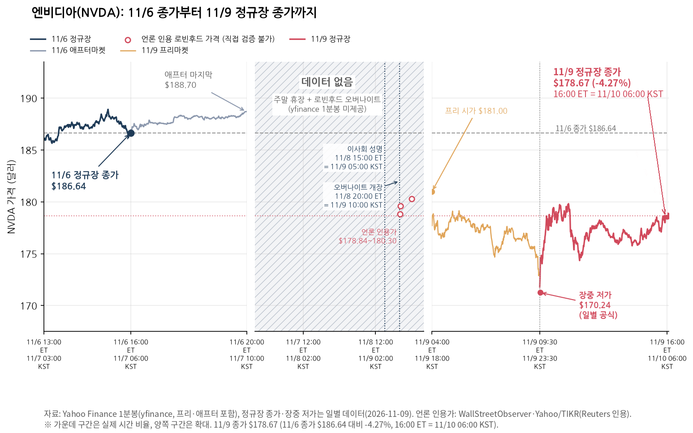
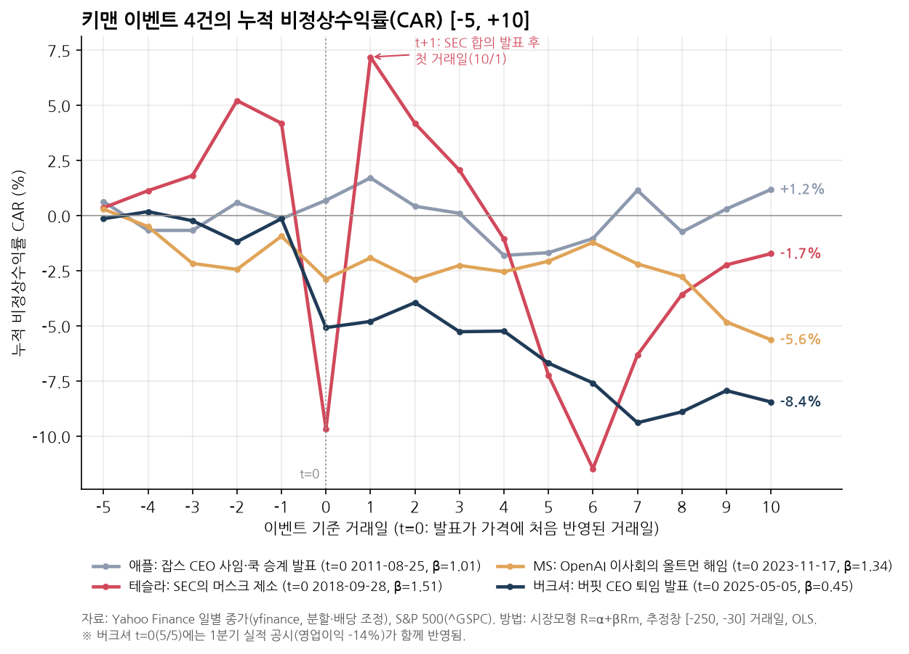
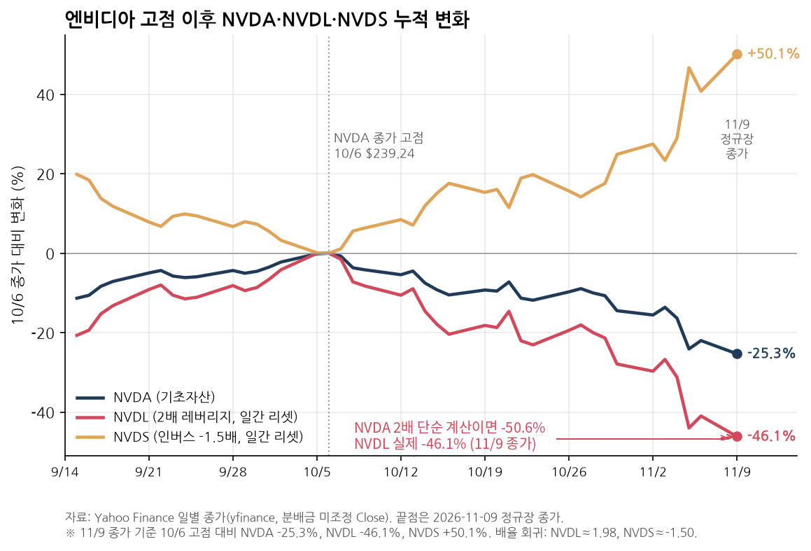
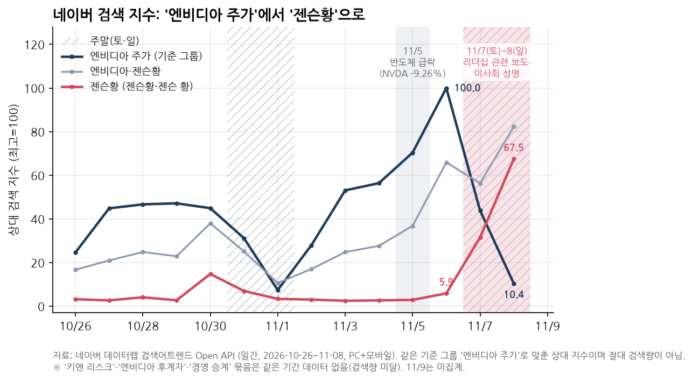

11월 9일 정규장 마감 기준으로 엔비디아(NVDA)는 전 거래일 대비 -4.27%(178.67달러) 하락했다. 전날 밤 [로빈후드 24시간 거래](https://www.yna.co.kr/view/AKR20261109110500009)에서 들리던 -3.4%~-4.2%와 크게 다르지 않은 숫자라, 겉으로만 보면 요란했던 주말 뉴스에 비해 선방한 것처럼 보인다.

하지만 같은 날 S&P 500 지수는 +2.35% 올랐다. 엔비디아처럼 베타가 큰 종목(1.89)이 시장을 거슬러 4% 넘게 밀렸다는 건, 실제 충격이 단순 수익률의 두 배를 웃돌았다는 뜻이다. 시장 움직임을 걷어내고 계산한 당일 비정상수익률(AR)은 **-8.71%**였다.

## 주말 성명부터 정규장 종가까지

시작점은 11월 8일 일요일 오후 3시(미 동부시간, 한국시간 9일 새벽 5시)에 나온 [엔비디아 이사회 성명](https://investor.nvidia.com/news/press-release-details/2026/Statement-from-NVIDIA-Board-of-Directors/)이었다. 이사회는 리더십을 둘러싼 보도를 계기로 독립이사 위원회가 외부 변호인과 독립 조사를 진행한다고 알리면서, 말미에 젠슨황과 경영진에 대한 신뢰를 재확인했다. 11월 10일 오전까지 이와 별도로 SEC EDGAR에 새 8-K 공시는 올라오지 않았고, 최신 8-K는 9월 3일자다.

주말 사이 [야후 파이낸스](https://finance.yahoo.com/markets/stocks/articles/nvidia-slips-3-overnight-board-052125033.html)와 [아나돌루 통신](https://www.aa.com.tr/en/economy/nvidia-shares-fall-after-probe-into-ceo-jensen-huang/4116445) 등이 전한 오버나이트(20:00 ET 개장) 낙폭은 3.4~4.2% 수준이었다. 본장이 열린 9일에는 173.04달러로 갭 하락 출발해 장중 170.24달러까지 밀렸다가, 낙폭을 일부 만회하며 178.67달러(고가 179.91달러)로 마감했다.

_11월 6일 정규장 종가(186.64달러)부터 주말 오버나이트 구간, 11월 9일 프리마켓과 정규장 종가(178.67달러)까지의 흐름._

주의할 점은 직전 하락분과 섞지 않는 것이다. 엔비디아는 보도 이전인 11월 5일에도 반도체 업종 매도세에 하루 -9.26% 빠졌다. 10월 6일 종가 고점(239.24달러) 기준으로 보면 11월 6일 종가가 이미 -22.0% 구간이었고, 9일 종가로 -25.3%까지 내려왔다. 이번 이슈만의 몫은 6일 종가 대비 9일의 움직임만 따로 떼어 봐야 한다.

## -4.27% 뒤에 가려진 시장모형 AR -8.71%

핵심 인물을 둘러싼 리스크는 거칠게 두 변수의 곱으로 분해할 수 있다. 그 사람이 회사를 떠날 확률을 $p$, 이탈했을 때 깎이는 기업가치 비율을 $k$라고 두면 주가 반응은 대략 다음과 같다.

$$
\frac{\Delta P}{P} \approx -\,p \times k
$$

식 자체는 단순하지만 해석이 늘 엇갈리는 이유가 여기에 있다. 주가가 약 4% 빠졌을 때 시장이 이탈 확률 $p$를 10%로 보고 $k$를 40%로 매긴 것인지, 아니면 $p=20\%$, $k=20\%$로 본 것인지 수익률 하나만으로는 구분이 안 된다. 거기에 지수 등락까지 얹히면 착시가 커진다.

그래서 개별 종목의 고유 충격을 발라내려면 이벤트 스터디(event study)가 필요하다. 사건 전 [-250, -30] 거래일 구간에서 S&P 500(`^GSPC`)으로 회귀한 시장모형을 추정한다.

$$
R_{i,t} = \alpha_i + \beta_i R_{m,t} + \varepsilon_{i,t}
$$

이 모형이 예측한 기대수익률을 실제 수익률에서 뺀 값이 비정상수익률(AR), 이를 이벤트 구간에 걸쳐 더한 값이 누적 비정상수익률(CAR)이다.

$$
AR_{i,t} = R_{i,t} - (\hat{\alpha}_i + \hat{\beta}_i R_{m,t}), \qquad CAR_i[t_1, t_2] = \sum_{t=t_1}^{t_2} AR_{i,t}
$$

이사회 성명이 일요일에 나왔으므로 첫 반영일인 11월 9일이 t=0이다. 추정창에서 구한 엔비디아의 베타(β)는 약 1.89, 추정창 AR의 일간 표준편차는 약 1.82%였다. 9일 S&P 500이 +2.35% 올랐으니 엔비디아의 기대수익률은 +4.4%대였는데 실제론 -4.27%에 그쳤다. 결과적으로 t=0 하루의 비정상수익률은 **-8.71%**로, 평소 변동폭의 **-4.8배(-4.8σ)**에 달한다.

| 구간 | 수익률 / 누적값 | 비고 |
|---|---|---|
| 단순 수익률 (t=0) | -4.27% | 11/9 종가(178.67달러) vs 11/6(186.64달러) |
| 비정상수익률 (AR, t=0) | **-8.71%** | β ≈ 1.89, S&P 500 +2.35% 반영 (-4.8σ) |
| CAR[-1, 0] | -6.53% | t=+1 이후 미집계 |
| CAR[-5, 0] | -12.40% | 직전 주 반도체 매도세 포함 |

엔비디아는 [11월 17일 장 마감 후 실적 발표](https://investor.nvidia.com/news/press-release-details/2026/NVIDIA-Sets-Conference-Call-for-Third-Quarter-Financial-Results/default.aspx)(13:20 PT 실적 공개, 14:00 PT 컨퍼런스 콜)가 잡혀 있다. 5거래일 뒤인 11월 16일(t=+5) 이후로는 실적 변수가 섞이기 때문에, 이번 사건의 순수한 여진만 재려면 CAR[0, +5] 선에서 끊어 보는 편이 정확하다.

## 과거 네 번의 키맨 이벤트와 비교하면

-8.71%(-4.8σ)라는 숫자가 역사적으로 어느 정도 위치인지 보려고, 같은 기준(추정창 [-250, -30], S&P 500 시장모형)으로 대표 사례 네 건을 뽑아 비교했다.

| 사례 | t=0 | 단순 수익률 (t=0) | AR (t=0) | CAR[-5,+10] |
|---|---|---:|---:|---:|
| [애플, 잡스 CEO 사임](https://www.latimes.com/archives/blogs/money-company/story/2011-08-25/apple-stock-posts-small-loss-as-buyers-move-in-after-early-drop) (2011) | 2011-08-25 | -0.65% | +0.83% | +1.2% |
| [테슬라, SEC 머스크 제소](https://www.cnbc.com/2018/09/28/tesla-shares-plunge-after-wall-street-panics-over-the-sec-lawsuit-against-musk.html) (2018) | 2018-09-28 | -13.90% | -13.85% | -1.7% |
| [MS, OpenAI 올트먼 해임](https://www.cnn.com/2023/11/20/investing/microsoft-stock-record-high-altman-openai) (2023) | 2023-11-17 | -1.68% | -1.95% | -5.6% |
| [버크셔, 버핏 CEO 퇴임](https://www.reuters.com/markets/us/berkshire-hathaway-shares-fall-buffett-step-down-ceo-year-end-2025-05-05/) (2025) | 2025-05-05 | -5.12% | -4.94% | -8.4% |

_동일한 S&P 500 시장모형(추정창 [-250, -30])으로 비교한 4건의 누적 비정상수익률(CAR) 궤적._

네 곡선은 둘로 갈린다.

애플(2011)과 마이크로소프트(2023)의 t=0 충격은 평소 변동 범위(±2σ) 안에서 지나갔다. 잡스는 이미 1월부터 병가 상태였고 팀 쿡 승계 구도가 시장에 완전히 반영돼 있었기 때문에, 시간외 하락을 정규장에서 바로 메우며 당일 AR이 오히려 +0.83%였다. MS 역시 외부 파트너사의 쇼크였을 뿐이고, 다음 거래일 올트먼 영입 발표와 함께 사상 최고 종가(+2.05%)를 갈아치웠다.

반면 테슬라(2018)와 버크셔(2025)는 t=0 충격을 약 **-5σ** 크기로 맞았다. 특히 테슬라(β=1.51)는 9월 27일 장 마감 후 SEC가 머스크를 제소하자 'CEO직을 잃을 수 있다'는 가능성만으로 28일 -13.90% 급락했다가, 주말인 29일 [합의 소식](https://www.cnbc.com/2018/10/01/tesla-shares-surge-over-15-percent-after-sec-settlement.html)이 나오자 월요일(10월 1일) +17.35% 되돌리며 10거래일 CAR을 -1.7%까지 줄였다. 엔비디아의 11월 9일(-4.8σ)은 크기만 놓고 보면 애플·MS 쪽이 아니라 테슬라·버크셔 쪽에 걸쳐 있다.

재무학의 CEO 급사(sudden death) 연구를 겹쳐 보면 이 흐름이 더 선명해진다. [Johnson 외(1985)](https://doi.org/10.1016/0165-4101(85)90034-5)가 1971~1982년 급사 53건을 분석했을 때 비창업자 경영진은 -0.83% 빠졌지만 창업자(15건)는 오히려 +3.50% 올랐고, [Salas(2010)](https://doi.org/10.1016/j.jbankfin.2009.09.002)는 10년 이상 재임하며 실적이 부진했던 경영진이 사라질 때 +6.8% 반등(참호화 해소)이 나타난다고 봤다. 하지만 시대가 바뀌면서 정반대 경향이 강해졌다. [Quigley 외(2017)](https://doi.org/10.1002/smj.2504)가 1950~2009년 급사 240건을 추적한 결과, CEO 한 명에 대한 주가 반응의 절대 크기는 최근으로 올수록 뚜렷하게 커졌다. 다만 급사 데이터는 $p=1$(확정 이탈)인 경우라, 이탈 여부 자체가 불확실한 엔비디아에 단순 평균치를 그대로 대입할 수는 없다.

## 공시에는 '승계 계획'이 빠져 있다

애플이 -0.65% 선에서 충격을 소화하고 곧바로 제자리를 찾은 핵심 배경은 후임이 눈에 보였다는 점이다. 엔비디아의 공시 서류를 열어보면 이 부분이 비어 있다.

[FY2026 Form 10-K](https://www.sec.gov/Archives/edgar/data/1045810/000104581026000021/nvda-20260125.htm) 위험요인 항목에는 장기 재임 경영진에 대한 높은 의존도(*"highly dependent on the services of our longstanding executive team"*)와 효과적인 승계 계획 실패 시 장기 성과가 훼손될 수 있다는 문구가 들어 있다. 하지만 CEO 개인을 지목하거나 구체적인 승계 구도를 적은 대목은 없다. [2026년 위임장(DEF 14A)](https://www.sec.gov/Archives/edgar/data/1045810/000104581026000036/nvda-20260512.htm)을 보면 이사회 10명 중 9명이 독립이사이고, 1993년 창업 때부터 CEO 겸 이사를 맡아 온 젠슨황(지분 3.58%)과 별개로 독립 Lead Director가 이사회를 조율하는 구조다. 이번 독립 조사를 위원회가 끌고 갈 수 있는 근거도 여기에 있다. ([Nguyen & Nielsen(2010)](https://doi.org/10.1016/j.jfineco.2010.07.004)에 따르면 시장은 독립이사의 급사에도 평균 -0.85%의 감시 가치를 매긴다.)

문제는 정작 투자자가 확인하고 싶은 2026년 위임장 본문에 'succession'이라는 단어가 한 번도 나오지 않는다는 점이다. 흔히 대안으로 거론되는 키맨 보험 역시 사망·장애만 보장할 뿐, 리더십 불확실성이나 거버넌스 조사로 빠지는 주가는 메워 주지 못한다. 승계 그림이 외부에 공유되지 않은 상태에서 독립 조사가 시작되니, 시장이 $k$ 값을 보수적으로 크게 잡을 수밖에 없는 구조다.

## 레버리지 ETF와 한국 검색창의 온도차

키맨 리스크처럼 결론이 오락가락하는 이벤트는 일간 리셋 레버리지 ETF를 들고 있는 쪽에 훨씬 가혹하게 작동한다. 배율 $L$인 상품의 가치는 기초자산의 일간 수익률 $r_t$에 따라 매일 새로 계산된다.

$$
V_t = V_{t-1}\,(1 + L \cdot r_t)
$$

2026년 일간 수익률로 회귀해 보면 NVDL의 실제 추종 배율은 1.98배, 인버스 NVDS는 -1.50배로 상품 설계와 일치한다.

_10월 6일 고점(239.24달러) 이후 11월 9일까지 NVDA(-25.3%), NVDL(-46.1%), NVDS(+50.1%)의 누적 수익률 비교._

10월 6일 고점부터 11월 9일 종가까지 NVDA가 -25.3% 내리는 동안 NVDL은 -46.1%(종가 21.64달러, 장중 저가 19.53달러), NVDS는 +50.1%(종가 24.77달러)를 기록했다. 하락이 비교적 한 방향으로 이어진 탓에 지금까지는 단순 2배 계산(-50.6%)보다 덜 빠졌지만, 진짜 위험은 11월 9일 이후다. 테슬라 사례(-13.90% 다음 날 +17.35%)처럼 이벤트 결론에 따라 하루 +10%, 다음 날 -10% 왕복이 나오면 본주는 -1%($1.1 \times 0.9 = 0.99$)만 깎여도 2배 상품은 -4%($1.2 \times 0.8 = 0.96$)가 녹는다. 9일 하루 NVDL(-8.73%)이 단순 2배(-8.54%)보다 조금 더 밀린 것도 장중 저점(170.24달러, NVDL 19.53달러)까지 흔들린 변동성 영향이다.

_10월 26일~11월 8일 네이버 데이터랩 상대 검색 지수(기준: '엔비디아 주가' 11/6=100)._

국내 개인 투자자의 시선도 딱 사람 쪽에만 쏠려 있다. 10월 26일~11월 8일 네이버 데이터랩 상대 지수를 보면, '엔비디아 주가'는 11월 6일 정점(100)을 찍은 뒤 8일 일요일 10.4로 꺾인 반면 '젠슨황'은 5.9에서 67.5로 급등했다. 직전 일요일(11월 1일)에도 '엔비디아 주가' 지수가 7.4까지 내려갔던 만큼 일요일 검색 감소에는 주말 효과가 섞여 있지만, 젠슨황의 급등세는 뚜렷하다. 같은 기간 '키맨 리스크', '엔비디아 후계자', '경영 승계' 묶음은 집계 최소 기준에도 미치지 못했다. 인물이 흔들린다는 사실에는 민감하게 반응하면서도, 정작 주가를 방어할 승계 구조에는 관심이 거의 없었다는 뜻이다.

---

11월 17일 실적 발표 전까지 지켜봐야 할 숫자는 두 가지다. 첫째, 11월 10일부터 16일까지의 CAR[0, +5]가 버크셔(-8.4%) 쪽으로 추가 하락을 이어가는지, 아니면 조사 범위를 둘러싼 불확실성이 걷히며 테슬라(-1.7%)처럼 되돌림이 나오는지다. 둘째, 이번 조사 국면이나 17일 실적 콜에서 이사회·경영진이 후계·승계 체계를 처음으로 구체화하는지 여부다. 애플과 테슬라가 보여주듯 시장은 CEO 개인의 유고 가능성 자체보다 '다음 사람이 안 보이는 상태'에 훨씬 큰 할인을 매긴다.

<small>데이터: 주가·지수 일별/1분봉은 Yahoo Finance(yfinance), 검색 추이는 네이버 데이터랩 Open API 기준. 이 글은 정보 제공 목적이며 특정 종목·상품의 매수나 매도를 권유하지 않는다.</small>
