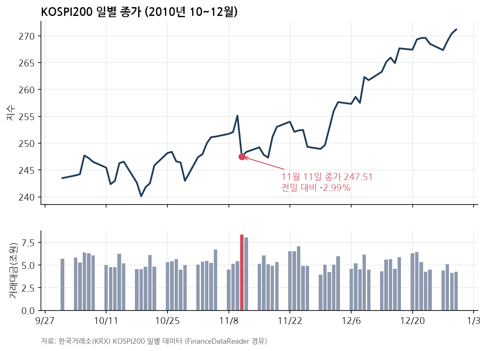
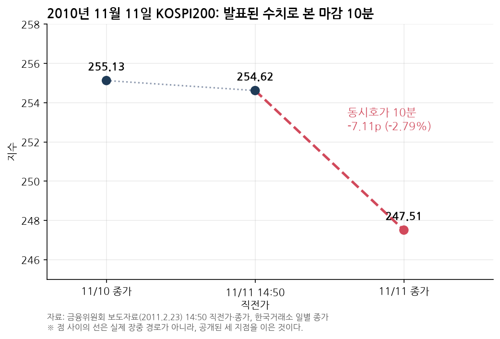
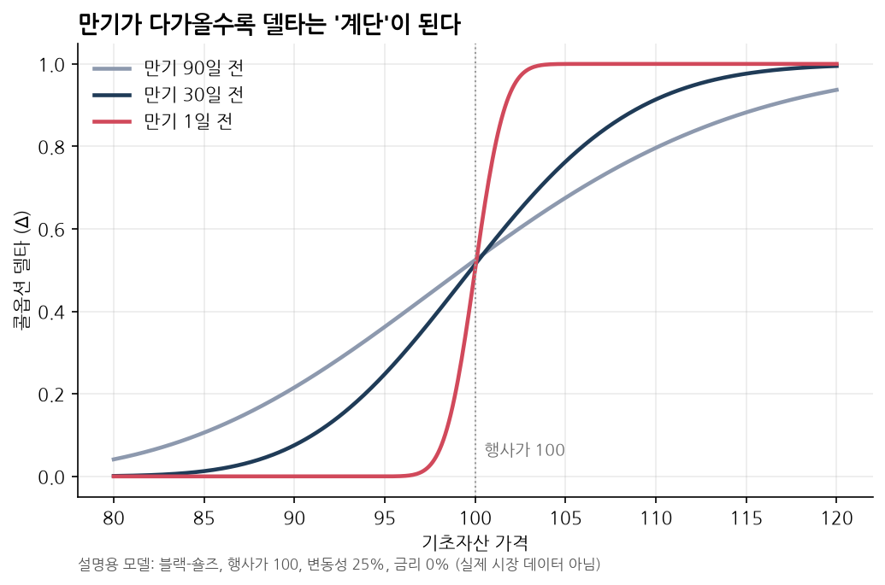
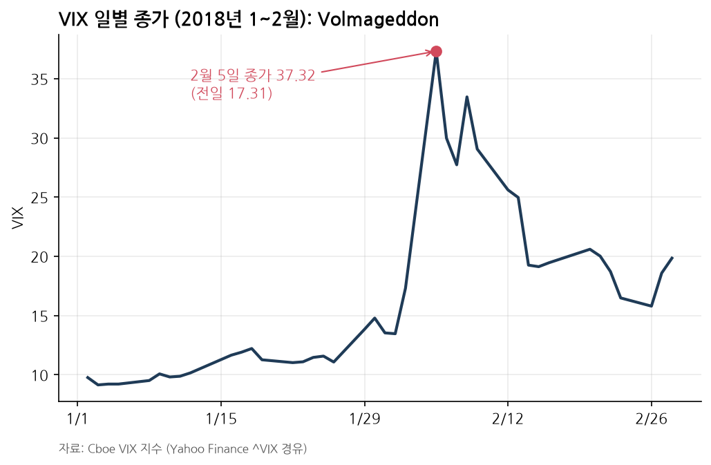

> **3줄 요약**
> 1. 2010년 11월 11일 옵션 만기일, 장 마감 10분 동안 2조 4,424억원어치 매도 주문이 쏟아져 KOSPI200이 2.79% 급락했습니다.
> 2. 이 물량은 지수차익거래로 쌓아 둔 현물 바스켓이었습니다. 금융당국은 미리 풋옵션을 사 둔 뒤 바스켓을 던진 **연계 시세조종**으로 판단했습니다.
> 3. 교훈은 하나입니다. 포지션은 만기에 반드시 풀리고, 그 순간 종가는 펀더멘털이 아니라 **청산 수급**이 만듭니다.

## 빼빼로 데이 오후 2시 50분

16년 전 11월 11일도 빼빼로 데이였습니다. 거리에는 빼빼로 상자가 쌓여 있었고, 여의도에서는 KOSPI200 옵션 만기가 돌아왔습니다.

장중 시장은 조용했습니다. 이날 KOSPI200은 254.86으로 출발해 장중 256.51까지 올랐고, 오후 2시 50분 직전가는 254.62였습니다.

종가를 정하는 동시호가 10분이 시작되자 분위기가 바뀌었습니다. 도이치증권 창구로 삼성전자를 포함한 199개 종목, **2조 4,424억원**어치 매도 주문이 7번에 걸쳐 들어왔습니다. 가격은 모두 직전 체결가보다 **4.5~10% 낮게** 매겨져 있었습니다.

결과는 이렇습니다.

- KOSPI200: 10분 만에 **254.62 → 247.51 (−7.11p, −2.79%)**. 종가가 그날의 최저가였습니다.
- 코스피: 하루 동안 **1,967.85 → 1,914.73 (−53.12p)**.
- 미리 풋옵션을 사 둔 쪽의 부당이득: **448억 7천만원** (금융위원회 조사 결과).

*자료: 한국거래소(KRX) KOSPI200 일별 데이터(FinanceDataReader 경유). 11월 11일 KOSPI200 거래대금은 약 8.36조원으로, 전날(약 5.41조원)보다 크게 늘었다.*

차트로 보면 11월 11일 하루만 뚝 떨어진 뒤 지수는 다시 제 길을 갑니다. 펀더멘털이 바뀐 날이 아니었다는 뜻입니다. 빼빼로처럼 하루만 '뚝' 부러진 이 날에 무슨 일이 있었는지 따라가 보겠습니다.

*자료: 금융위원회 보도자료(2011.2.23)의 14:50 직전가와 종가, 한국거래소 일별 종가. 분 단위 장중 데이터가 아니라 공개된 세 지점을 이은 그림이다.*

## 2조원어치 주식은 어디서 왔나: 지수차익거래와 베이시스

이 주식은 하루아침에 생긴 물량이 아니었습니다. 금융위원회에 따르면 도이치 측이 **2010년 한 해 동안 지수차익거래로 사 모아 보유하던 현물 바스켓**이었습니다.

### 베이시스: 선물과 현물의 간격

지수선물의 이론가격은 대략 다음과 같습니다.

$$
F = S \cdot e^{(r-q)T}
$$

$S$는 현물지수, $r$은 금리, $q$는 배당수익률, $T$는 만기까지 남은 기간입니다. 실제 선물가격과 현물지수의 차이($F - S$)를 **베이시스**라고 부릅니다.

시장 선물가격이 이론가격보다 비싸면 차익거래자는 **선물을 팔고 현물 바스켓을 삽니다(매수차익거래).** 지수가 오르면 현물에서 벌고 선물에서 잃습니다. 내리면 반대입니다. 그래서 방향과 상관없이 처음 벌어진 가격 차이만 챙기는 구조가 됩니다.

선물 대신 옵션으로 같은 효과를 낼 수도 있습니다. **콜 매도 + 풋 매수**를 조합하면 선물 매도와 똑같이 움직이는 **합성선물 매도**가 됩니다. 도이치가 쓴 것도 이 합성선물이었습니다.

### 만기에 베이시스는 0이 된다

KOSPI200 선물·옵션의 최종 정산 기준은 **만기일 KOSPI200 종가**입니다. 그래서 만기일 종가에서 선물과 현물의 간격은 0으로 수렴합니다.

차익거래자 입장에서는 이 순간에 현물을 팔아야 처음 계산한 이익이 정확히 확정됩니다. 다음 만기로 포지션을 넘기는 **롤오버**를 택할 수도 있지만, 청산하기로 했다면 정답은 대개 **'만기일 종가에 현물 매도'**입니다.

> 💡 **핵심**: 만기일 동시호가는 차익거래 청산 물량이 **구조적으로** 몰리는 시간입니다. 누가 조작하지 않아도 이 10분에는 수급이 쏠립니다.

## 델타로 다시 보기

여기서 파생상품의 언어인 **델타(Δ)**를 꺼내 보겠습니다. 델타는 기초자산 가격 $S$가 1만큼 움직일 때 파생상품 가치 $V$가 얼마나 변하는지를 나타냅니다.

$$
\Delta = \frac{\partial V}{\partial S}
$$

| 포지션 | 델타 | 지수가 오르면 |
|---|---|---|
| 현물 바스켓 매수 | +1 (지수 1단위당) | 이익 |
| 선물 매도 (또는 합성선물 매도) | −1 | 손실 |
| **차익거래 합계** | **≈ 0** | **거의 영향 없음** |
| 풋옵션 매수 | −1 ~ 0 | 손실 (내리면 이익) |

정상적인 차익 포지션은 델타가 0에 가깝습니다. 방향에 베팅하지 않는 포지션이라는 뜻입니다.

**델타헤지**는 이렇게 전체 델타를 0 근처로 맞춰 두는 기법입니다. 그런데 옵션의 델타는 가만히 있지 않습니다. 델타가 변하는 속도를 **감마(Γ)**라고 하는데, 만기에 가까울수록 감마가 커집니다.

*설명용 모델: 블랙-숄즈, 행사가 100, 변동성 25%, 금리 0%. 실제 시장 데이터가 아니다.*

만기 90일 전에는 완만하던 곡선이 만기 하루 전에는 행사가 근처에서 거의 **계단**이 됩니다. 기초자산이 조금만 움직여도 델타가 0에서 1로 뒤집힙니다. 만기일에 헤지 수량을 크게, 한꺼번에 바꿔야 하는 이유가 여기 있습니다.

**델타 언와인딩**은 이렇게 쌓아 둔 헤지·차익 포지션을 줄이거나 청산하면서 기초자산을 대량으로 사고파는 과정입니다.

## 풀리는 물량이 가격을 움직이는 네 가지 이유

1. **시점이 몰립니다.** 정산 기준이 종가라서 청산 물량이 종가를 정하는 짧은 시간에 집중됩니다.
2. **유동성에는 한계가 있습니다.** 10분 동안 받아 줄 반대편 주문은 한정돼 있습니다. 큰 물량은 호가를 여러 단계 밀어내며 체결됩니다.
3. **단일가 방식이 충격을 키웁니다.** 동시호가는 주문을 모았다가 하나의 가격으로 체결합니다. 마감 직전에 낮은 가격의 대량 주문이 들어오면 예상 체결가 전체가 끌려 내려갑니다.
4. **물량이 예측 가능하면 남이 먼저 움직입니다.** 누가 언제 얼마를 팔아야 하는지 알려져 있으면 다른 참가자가 앞서 매매해 움직임이 더 커집니다.

당시에는 만기일 프로그램 매매를 **장 종료 15분 전(오후 2시 45분)까지 거래소에 미리 신고**하는 제도가 있었습니다. 시장이 대비할 시간을 주자는 취지였습니다. 하지만 자본시장연구원 자료는 이 제도에 빈틈이 있었다고 지적합니다. 대규모 호가가 신고돼 불균형이 예상돼도 다른 회원들은 신고한 대로만 호가를 낼 수 있어서, 마감 직전 매물 폭탄에 손을 쓸 수 없었다는 것입니다. 11·11은 이 빈틈을 이용했습니다.

## '헤지 청산'과 '연계 시세조종' 사이

여기서 선을 분명히 그어야 합니다. 차익 바스켓을 만기일 종가에 파는 일 자체는 불법이 아닙니다. 정상적인 청산이라면 현물을 싸게 팔아 잃는 만큼 선물·옵션 쪽에서 상쇄되기 때문에, 종가를 누를 이유가 없습니다.

금융위원회가 문제 삼은 것은 **순서와 델타**였습니다.

- **① 델타를 기울였습니다.** 14시 19분 50초부터 14시 49분 59초까지, 동시호가 직전 30분 동안 정상적인 차익 포지션을 넘어서는 **합성선물 매도와 풋옵션 매수**를 새로 쌓았습니다. 델타 0이던 장부가 지수가 내리면 돈을 버는 **음(−)의 델타**로 바뀐 것입니다.
- **② 그다음 가격을 눌렀습니다.** 동시호가 10분 동안 현물 바스켓을 직전가보다 4.5~10% 낮은 가격에 한꺼번에 던졌습니다.
- **③ 이익은 파생상품에서 났습니다.** 지수가 떨어지자 풋옵션 가치가 올라 448억 7천만원의 이익이 생겼습니다.

> ⚠️ **포인트**: 헤지 포지션을 '푸는 것'은 위험관리입니다. 풀기 직전에 반대 방향 베팅을 얹고 그 청산으로 가격을 움직이는 것은 **현물·파생 연계 시세조종**이 됩니다. 차이는 매매 자체가 아니라 장부의 델타에 있습니다.

## 그 후: 제재, 재판, 그리고 무너진 운용사

### 당국 제재

금융감독원과 한국거래소는 사건 다음 날인 2010년 11월 12일 공동조사에 착수했습니다. 2011년 2월 23일 금융위원회는 도이치은행 홍콩지점 직원 등 관련자 5명과 한국도이치증권을 검찰에 고발했습니다. 한국도이치증권에는 **6개월 일부 영업정지**(2011.4.1~9.30)가 내려졌습니다.

### 형사재판: 13년 만의 결말

형사재판의 결말은 의외입니다.

- **1심 (2016년 1월)**: 한국도이치증권 박모 상무 징역 5년, 법인 벌금 15억원.
- **항소심 (2018년 12월)**: 두 피고 모두 무죄. 박 상무가 투기적 포지션 구축과 시세조종을 공모했다는 증거가 부족하다는 이유였습니다.
- **대법원 (2023년 12월)**: 무죄 확정.

주범으로 지목된 도이치은행 홍콩지점 외국인 임원 3명은 2011년 8월 기소됐습니다. 하지만 한 번도 국내 법정에 나오지 않았고, 2024년 1월 보도 기준으로 인터폴 수배 상태입니다. 2036년 8월까지 유죄가 확정되지 않으면 처벌할 수 없게 됩니다(연합뉴스, 2024.1.17).

### 민사: 시세조종 책임은 인정

민사에서는 판단이 달랐습니다. 2015년 11월 서울중앙지법은 도이치은행·증권의 손해배상 책임을 처음 인정했습니다. 같은 달 피해 금융사 5곳에 피해액의 80%인 280억원 상당을 배상하라는 화해권고 결정도 확정됐습니다. 2018년 9월 대법원은 개인투자자의 손해배상 청구권이 아직 시효로 소멸하지 않았다고 판단했습니다.

### 반대편에 서 있던 운용사

그날 반대편에서 직격탄을 맞은 곳도 있습니다. 와이즈에셋자산운용은 한 사모파생펀드에서 콜과 풋을 동시에 파는 **양매도** 전략을 쓰다가 하루에 **899억원**의 손실을 냈습니다. 양매도는 지수가 범위 안에 머물면 프리미엄을 벌지만, 범위를 벗어나면 손실이 커지는 구조입니다. 다시 말해 큰 음(−)의 감마를 진 포지션이었습니다.

결제를 맡은 하나대투증권은 약 760억원을 대신 결제했습니다(매일경제, 2010.11.12). 와이즈에셋은 2012년 8월 금융위원회에서 금융투자업 인가가 취소됐습니다. 자본시장법 시행 이후 운용사 인가 취소는 처음이었습니다.

> 💡 **핵심**: 한쪽의 언와인딩은 반대편 누군가에게는 감마 리스크로 돌아옵니다.

## 바뀐 규칙: 랜덤엔드와 사후보고

한국거래소는 2011년 1월 재발 방지책을 내놓았고, 2011년 5월 30일부터 시행했습니다.

| 제도 | 이전 | 개선 (2011.5.30 시행) |
|---|---|---|
| 프로그램 호가 사전보고 | 14:45까지 신고한 대로만 호가 제출 | 신고된 매수·매도 불균형이 기준(차이 비율 75% 초과, 차액 5천억원 초과)에 해당하면 거래소가 즉시 공표. 반대편 프로그램 호가를 추가로 낼 수 있고 16시까지 사후보고 |
| 랜덤엔드(임의종료) | 예상 체결가와 5% 이상 괴리 시 발동 | 최종거래일 종가 결정 때 직전가가 잠정 종가보다 3% 이상 높거나 낮으면 호가 접수를 최대 5분 연장 |

랜덤엔드는 종가가 정해지는 시점을 무작위로 만들어, 마감 직전 '한 방'을 노리는 전략의 효용을 떨어뜨립니다. 사후보고는 일방적인 매물 폭탄이 예고되면 반대편 유동성이 들어올 길을 열어 줍니다. 두 장치 모두 **청산 수급이 종가를 한쪽으로 끌고 가는 힘**을 줄이려는 것입니다.

## 같은 원리, 다른 무대

### ELS 상환평가일

ELS 발행사나 헤지 상대방은 기초주식을 델타만큼 들고 있다가, 조기상환이 확정되면 그 주식이 필요 없어집니다. 그래서 상환평가일 종가 무렵에 대량 매도가 몰리기 쉽습니다.

2009년 8월 26일 한 ELS의 만기평가일, 장 마감 직전 KB금융 주가는 상환조건(54,740원)을 살짝 넘는 54,800원이었습니다. 마지막 10분 동안 도이체방크가 12만 8천주를 집중 매도했고, 주가가 100원 떨어지면서 투자자는 원금의 74.9%만 돌려받았습니다. 대법원은 2016년 이를 시세조종으로 판단했습니다.

반면 같은 날 BNP파리바 사건에서는 "델타헤지 원리에 부합한다"며 은행의 손을 들어줬습니다. 법원의 기준은 시기, 수량, 방법이 **헤지 목적에 맞느냐**였습니다. 한국거래소는 2009년 10월부터 'ELS 헤지거래 가이드라인'을 시행해 헤지 물량을 장중에 분산하도록 요구하고 있습니다.

### 2018년 Volmageddon

*자료: Cboe VIX 지수(Yahoo Finance ^VIX 경유).*

2018년 2월 5일 VIX는 전일 17.31에서 37.32로 올랐습니다. BIS는 이를 1987년 이후 가장 큰 일간 상승(약 20포인트)으로 기록했습니다.

레버리지·인버스 변동성 상품이 모두 장 마감 직후 VIX 선물을 사야 하는 구조였고, 16시 08분 1분 동안 시장의 약 4분의 1에 해당하는 115,862계약이 거래됐습니다. 인버스 상품 XIV는 84% 떨어진 뒤 조기 상환으로 사라졌습니다. 시점이 정해진 기계적 리밸런싱이 가격을 밀어 올렸다는 점에서 11·11과 같은 원리입니다.

## 용어 정리

| 용어 | 뜻 |
|---|---|
| 델타(Δ) | 기초자산 1단위 변화에 대한 파생상품 가치 변화 |
| 감마(Γ) | 델타의 변화 속도. 만기 직전 행사가 근처에서 커짐 |
| 베이시스 | 선물가격과 현물지수의 차이. 만기에 0으로 수렴 |
| 지수차익거래 | 선물과 현물 바스켓의 가격 차이를 노리는 거래. 델타는 0에 가까움 |
| 합성선물 | 콜과 풋을 조합해 선물처럼 움직이게 만든 포지션 |
| 언와인딩 | 쌓아 둔 헤지·차익 포지션을 줄이거나 청산하는 것 |
| 동시호가(단일가매매) | 주문을 모아 하나의 가격으로 체결하는 방식. 만기일 종가를 결정 |
| 랜덤엔드 | 단일가매매 종료 시점을 임의로 연장해 마감 직전 호가 왜곡을 줄이는 제도 |

## 마무리: 만기일 종가는 '청산 수급'이 만든다

평소 가격은 실적과 금리, 기대가 만듭니다. 하지만 만기일 종가 몇 분 동안은 이야기가 다릅니다. 그 순간 가격을 정하는 것은 **풀려야 하는 포지션의 크기와 방향**입니다.

만기일 종가를 볼 때 세 가지를 확인해 보세요.

- **풀릴 물량**: 차익잔고, 헤지 잔고처럼 쌓여 있는 포지션은 얼마나 되는가?
- **시점**: 그 물량이 종가 단일가처럼 짧은 시간에 몰리는 구조인가?
- **유인**: 종가가 특정 수준이 되면 이익을 보는 쪽이 있는가? 장부의 델타는 정말 0인가?

빼빼로는 달콤하게 부러지지만 시장이 부러지는 소리는 꽤 쓰게 들립니다. 2010년 11월 11일이 남긴 교훈은 단순합니다. **포지션은 언젠가 반드시 풀리고, 그 순간 가격은 수급이 정한다.**

---

## 참고 자료

**사건·제재**
- 금융위원회, "Unfair Trading Investigation Results and Penalties" (2011-02-23): https://www.fsc.go.kr/eng/pr010101/21944
- 연합뉴스, "금융위 '옵션쇼크' 도이치증권 검찰 고발" (2011-02-23): https://www.yna.co.kr/view/AKR20110223225800008

**형사·민사 재판**
- 연합뉴스, "'옵션쇼크' 前 도이치 한국 임원 2심서 무죄" (2018-12-12): https://www.yna.co.kr/view/AKR20181212105700004
- 연합뉴스, "'도이치 옵션 쇼크' 前임원, 13년 만에 대법서 무죄 확정" (2024-01-17): https://www.yna.co.kr/view/AKR20240116147400004
- 한겨레, "'옵션쇼크' 도이치은행·증권 첫 손해배상 인정 판결" (2015-11-26): https://www.hani.co.kr/arti/society/society_general/719191.html
- 대법원 2018. 9. 13. 선고 2018다241403 판결 (국가법령정보센터): https://www.law.go.kr/LSW/precInfoP.do?precSeq=205730

**와이즈에셋자산운용**
- 매일경제, "와이즈에셋 11일 매도 폭탄으로 899억 손실" (2010-11-12): https://www.mk.co.kr/news/stock/4805090
- 연합인포맥스, "'11·11옵션쇼크' 와이즈에셋, 운용업계 첫 퇴출" (2012-08-22): https://news.einfomax.co.kr/news/articleView.html?idxno=32170

**제도 개선**
- 자본시장연구원, 자본시장 제도동향(한국거래소 규정 개정, 2011.2): https://www.kcmi.re.kr/kcmifile/oldfiledata/weekly_1_33_646.pdf
- 매일경제, "프로그램 호가 공시 16시까지 연장" (2011-01-27): https://www.mk.co.kr/news/stock/4850674
- 헤럴드경제, "거래소, 선물·옵션 최종거래일 충격 완화한다" (2011-01-27): https://biz.heraldcorp.com/article/10043037

**ELS 사례**
- 연합뉴스, "ELS 위험회피 거래 외국은행들 대법원서 희비 엇갈려" (2016-03-24): https://www.yna.co.kr/view/AKR20160324077051004
- 한국거래소, "주가연계증권(ELS) 헤지거래 가이드라인 제정·시행" (2009-09-21): https://www.yna.co.kr/view/RPR20090921010400353

**Volmageddon**
- BIS Quarterly Review (2018년 3월), "The equity market turbulence of 5 February": https://www.bis.org/publications/equity-market-turbulence-5-february-role-exchange-traded-volatility-products
- Credit Suisse, XIV ETN 가속상환 공시 (2018-02-06, SEC EDGAR): https://www.sec.gov/Archives/edgar/data/1053092/000095010318001572/dp86358_ex9901.htm

**데이터**
- 한국거래소 KOSPI·KOSPI200 일별 지수(FinanceDataReader 경유, 코스피는 Yahoo Finance ^KS11과 교차 확인), Cboe VIX(Yahoo Finance ^VIX). 차트 생성 스크립트: `make_charts.py`
