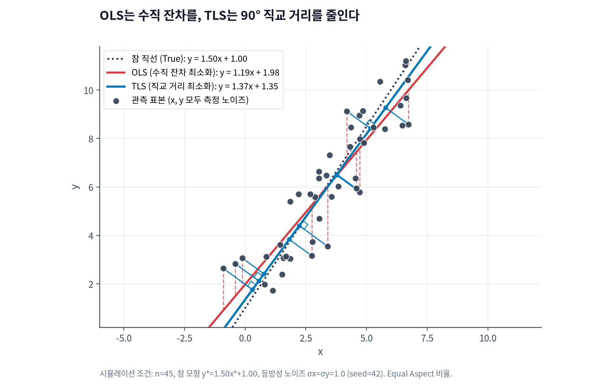
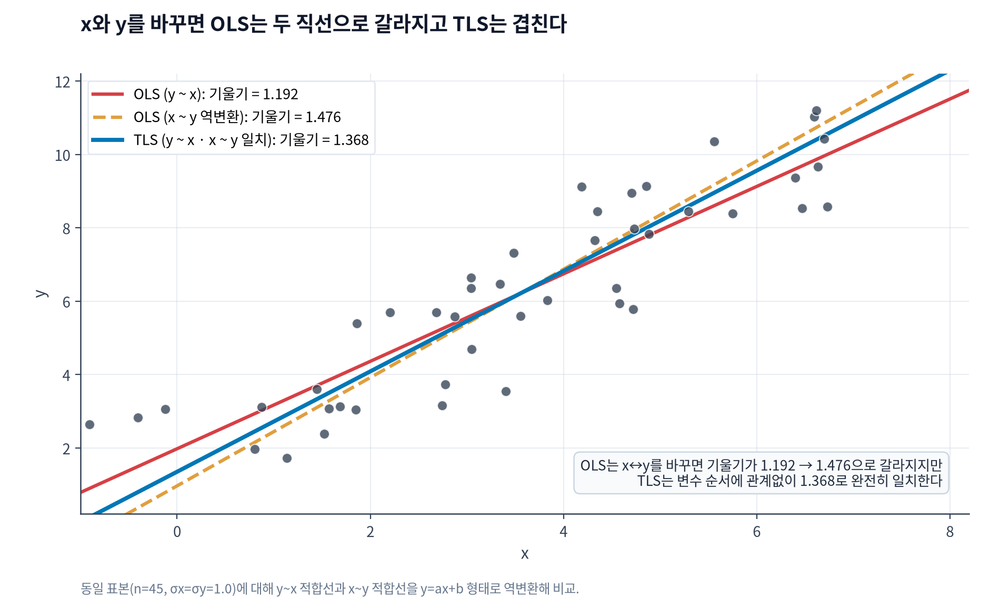
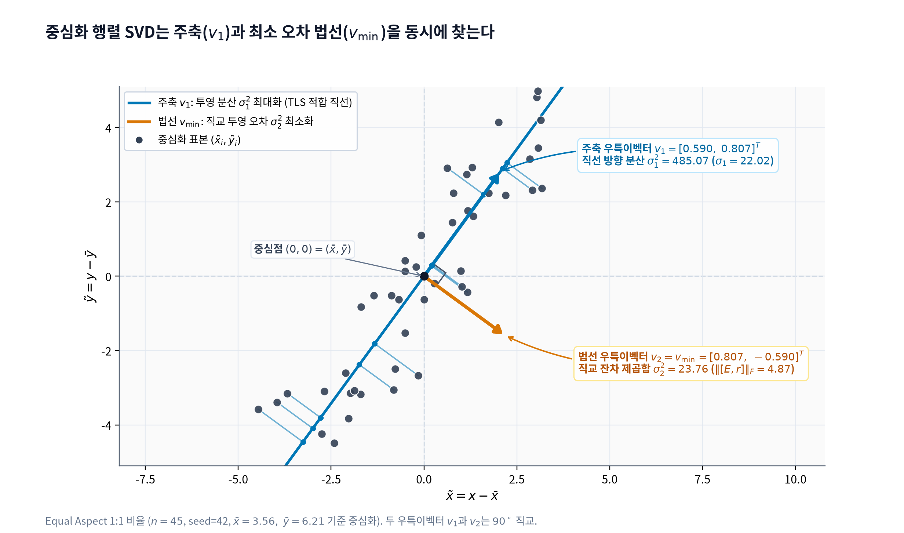
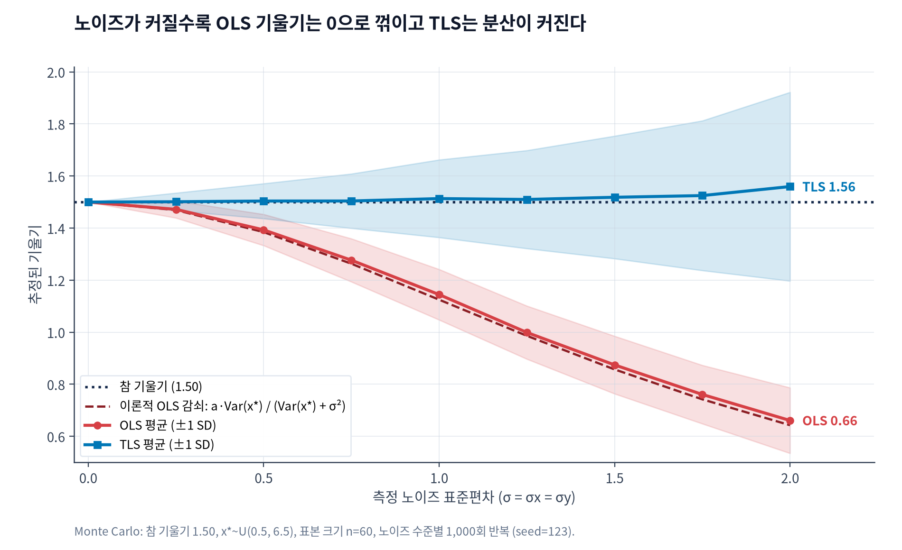
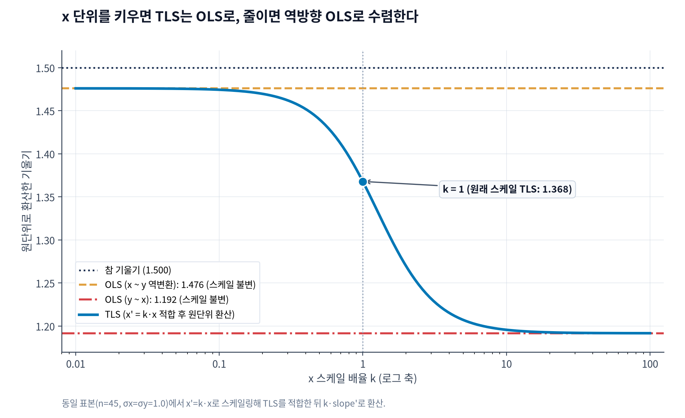

참 관계가 $y^* = 1.50x^* + 1.00$인 직선에서 표본 45개를 뽑고, $y$뿐 아니라 $x$에도 표준편차 1.0의 측정 노이즈를 섞으면 일반 최소제곱법(OLS)은 기울기를 **1.1917**(절편 1.9766)로 추정한다. 같은 데이터에 전최소제곱법(TLS, 직교 회귀)을 적용하면 기울기는 1.3679(절편 1.3499)가 된다.

이 차이는 회귀선이 오차를 어디서 재는가에서 비롯된다. OLS는 $x$를 정확한 상수로 가정하고 수직 잔차만 줄이는 반면, TLS는 $x$와 $y$ 양쪽 오차를 동시에 인정하고 직선까지의 최단 직교 거리를 줄인다.


_참 직선(y*=1.50x*+1.00)에 x·y 등방성 노이즈(σ=1.0)를 더한 45개 표본에 OLS와 TLS를 적합한 결과._

## 수직 잔차와 직교 거리

두 추정법이 푸는 최적화 문제와 성질은 여섯 가지 항목에서 갈린다.

| 구분 | OLS (일반 최소제곱법) | TLS (전최소제곱법 · 직교 회귀) |
|---|---|---|
| 오차 가정 | $x$는 무오차, $y$에만 오차 존재 | $x$와 $y$ 모두에 측정 오차 존재 ($\sigma_x = \sigma_y$) |
| 최소화 목적함수 | 수직 잔차 제곱합 $\sum (y_i - (ax_i + b))^2$ | 직교 거리 제곱합 $\sum \frac{(ax_i + b - y_i)^2}{a^2 + 1}$ |
| 계산 방식 | 정규방정식 / QR 분해 | 중심화 행렬 $[\tilde{X}, \tilde{y}]$의 SVD 최소 특이벡터 |
| 감쇠 편향 | $x$ 노이즈가 커질수록 기울기가 0으로 축소 | 등방성 노이즈 하에서 참 기울기 불편 추정 |
| 변수 대칭성 | 비대칭 ($y \sim x$와 $x \sim y$의 직선이 다름) | 완전 대칭 ($x \leftrightarrow y$ 교환 시 동일 직선) |
| 스케일 불변성 | 불변 ($x$ 단위 변환 후 환산 시 동일) | 민감 ($x$가 커지면 OLS, 작아지면 역방향 OLS로 수렴) |

위 45개 표본에서 손실 함수를 교차 계산하면 두 적합선이 각자의 목적함수를 정확히 최소화한다는 점이 드러난다. OLS 적합선은 수직 SSE 62.5027(직교 SSE 25.8264)을 기록해 TLS(수직 SSE 68.2326)보다 수직 잔차가 작고, TLS 적합선은 **직교 SSE 23.7639**로 OLS보다 직교 거리가 짧다.

## x와 y를 바꾸면 벌어지는 차이

관측 쌍 $(x_i, y_i)$에서 두 변수 모두 오차를 갖는다면 어느 쪽을 종속변수로 두느냐에 따라 직선이 달라져서는 안 된다. 그러나 OLS는 한쪽 축의 잔차만 최소화하므로 $y \sim x$로 적합한 직선과 $x \sim y$로 적합한 뒤 $y = ax + b$ 형태로 되돌린 직선이 서로 어긋난다.

같은 45개 표본에서 `OLS (y ~ x)`의 기울기는 1.1917이지만, `OLS (x ~ y)`를 역변환한 기울기는 **1.4761**(절편 0.9655)로 0.2844만큼 벌어진다. 반대로 TLS의 목적함수는 직선 $ax - y + b = 0$까지의 유클리드 거리를 재므로 $x$와 $y$의 역할을 바꿔도 기울기 1.3679와 절편 1.3499가 부동소수점 반올림 오차($10^{-16}$) 수준에서 그대로 일치한다.


_동일 표본에서 `y ~ x`와 `x ~ y` 역변환 직선을 비교하면 OLS는 갈라지고 TLS는 겹친다._

## 평균 중심화 SVD로 TLS 구하기

OLS가 반응변수 $y$만 수정해 $Xw = y + r$을 맞춘다면, [Golub & Van Loan(1980)](https://epubs.siam.org/doi/10.1137/0717073)이 정식화한 TLS는 입력 $X$와 출력 $y$ 양쪽 모두에 <button type="button" class="mn-ref" data-mn="mn-perturbation" aria-controls="mn-perturbation" aria-expanded="false">섭동(Perturbation)<sup class="mn-num">1</sup></button> $[E, r]$을 허용해 관측점 전체를 하나의 초평면 위로 옮긴다.

<aside id="mn-perturbation" class="mn-note" data-mn-for="mn-perturbation">
  <button type="button" class="mn-toggle" aria-expanded="false" aria-controls="mn-perturbation-body">
    <span class="mn-badge">1</span>
    <span class="mn-title">섭동 (Perturbation)</span>
    <span class="mn-chevron" aria-hidden="true"></span>
  </button>
  <div id="mn-perturbation-body" class="mn-body">
    <p>관측 행렬 $[X, y]$를 직선 위로 옮기기 위해 각 좌표에 더하는 미세한 보정량 $[E, r]$이다. 점 $(x_i, y_i)$를 적합 직선 위 $(x_i + e_i,\; y_i + r_i)$로 이동시키는 좌표 변화 벡터에 해당한다.</p>
  </div>
</aside>

보정 식 $(X + E)w = y + r$을 우변이 0이 되도록 넘겨 묶으면 TLS가 왜 행렬 근사 문제로 환원되는지 바로 드러난다.

$$
\begin{bmatrix} X + E & y + r \end{bmatrix} \begin{bmatrix} w \\ -1 \end{bmatrix} = \mathbf{0}
$$

이 식은 수정된 결합 행렬 $[X + E,\; y + r] \in \mathbb{R}^{n \times (p+1)}$이 영이 아닌 벡터 $[w^T, -1]^T$를 <button type="button" class="mn-ref" data-mn="mn-rank" aria-controls="mn-rank" aria-expanded="false">영공간(Null Space)<sup class="mn-num">2</sup></button>에 둔다는 뜻이다. 즉, 모든 수정된 점들이 $p$차원 초평면 위에 놓이면서 결합 행렬의 Rank가 $p+1$에서 최대 **Rank $p$ 이하**(1차원 직선은 Rank 1)로 줄어든다.

<aside id="mn-rank" class="mn-note" data-mn-for="mn-rank">
  <button type="button" class="mn-toggle" aria-expanded="false" aria-controls="mn-rank-body">
    <span class="mn-badge">2</span>
    <span class="mn-title">영공간과 Rank-p 근사</span>
    <span class="mn-chevron" aria-hidden="true"></span>
  </button>
  <div id="mn-rank-body" class="mn-body">
    <p>$Av = 0$을 만족하는 벡터 $v$의 공간이 Null Space, 독립적인 방향 수가 Rank다. Eckart-Young 정리에 따라 가장 가까운 Rank-$p$ 행렬은 SVD에서 큰 특이값 $p$개만 남기고 나머지를 버려 얻는다.</p>
  </div>
</aside>

각 관측점을 직선까지 수직으로 이동시키는 유클리드 거리 제곱합은 보정 행렬 $[E, r]$의 <button type="button" class="mn-ref" data-mn="mn-frobenius" aria-controls="mn-frobenius" aria-expanded="false">Frobenius Norm<sup class="mn-num">3</sup></button> 제곱 $\lVert [E, r] \rVert_F^2 = \sum_i (\lVert e_i \rVert_2^2 + r_i^2)$과 정확히 같다. 결국 TLS는 원래 결합 행렬에 Frobenius Norm 기준으로 가장 가까운 Rank-$p$ 행렬을 찾는 최적화 문제다.

<aside id="mn-frobenius" class="mn-note" data-mn-for="mn-frobenius">
  <button type="button" class="mn-toggle" aria-expanded="false" aria-controls="mn-frobenius-body">
    <span class="mn-badge">3</span>
    <span class="mn-title">Frobenius Norm</span>
    <span class="mn-chevron" aria-hidden="true"></span>
  </button>
  <div id="mn-frobenius-body" class="mn-body">
    <p>행렬 모든 원소의 제곱합에 제곱근을 취한 크기 지표($\lVert A \rVert_F = \sqrt{\sum_{i,j} A_{ij}^2}$)다. 벡터의 유클리드 $L_2$ Norm을 행렬로 확장한 값으로, 이를 줄이면 전체 점의 직교 이동 거리 제곱합이 최소화된다.</p>
  </div>
</aside>

표본 평균을 뺀 중심화 행렬 $\tilde{Z} = [\tilde{X}, \tilde{y}]$에 특이값 분해(<button type="button" class="mn-ref" data-mn="mn-svd" aria-controls="mn-svd" aria-expanded="false">SVD<sup class="mn-num">4</sup></button>)를 적용하면 데이터를 직교하는 성분들의 합으로 분해할 수 있다. 1차원 회귀($45 \times 2$ 행렬)에서는 두 개의 직교 축으로 나뉜다.

$$
\tilde{Z} = U \Sigma V^T = \sigma_1 u_1 v_1^T + \sigma_2 u_2 v_2^T \qquad (\sigma_1 \ge \sigma_2 \ge 0)
$$

<aside id="mn-svd" class="mn-note" data-mn-for="mn-svd">
  <button type="button" class="mn-toggle" aria-expanded="false" aria-controls="mn-svd-body">
    <span class="mn-badge">4</span>
    <span class="mn-title">특이값과 우특이벡터 (SVD)</span>
    <span class="mn-chevron" aria-hidden="true"></span>
  </button>
  <div id="mn-svd-body" class="mn-body">
    <p>$\tilde{Z}$를 직교 기저 $U, V$와 스케일 $\Sigma = \operatorname{diag}(\sigma_k)$로 분해한다. Unit Norm 방향 $v$ 위로 정사영한 크기 제곱합 $\lVert \tilde{Z}v \rVert_2^2$은 $v_1$에서 최대($\sigma_1^2$), $v_{\min}$에서 최소($\sigma_{\min}^2$)다.</p>
  </div>
</aside>

임의의 Unit Norm 벡터 $v$를 하나 고르면 $\lVert \tilde{Z} v \rVert_2^2 = \sum_{i=1}^n (\tilde{z}_i^T v)^2$은 모든 표본점을 $v$ 방향으로 정사영한 길이의 제곱합이다. 따라서 첫 번째 우특이벡터 $v_1$은 표본이 가장 길게 퍼진 적합 직선 자체의 방향을 잡는다. 반대로 $v_1$과 $90^\circ$ 직교하면서 투영 오차를 최소화하는 마지막 우특이벡터 $v_{\min}$(최소 특이값 $\sigma_{\min}$에 대응)은 적합 직선에 수직인 <button type="button" class="mn-ref" data-mn="mn-normal" aria-controls="mn-normal" aria-expanded="false">법선 벡터(Normal Vector)<sup class="mn-num">5</sup></button>가 되며, 이때 최소 직교 잔차 제곱합은 $\sigma_{\min}^2$과 일치한다.

<aside id="mn-normal" class="mn-note" data-mn-for="mn-normal">
  <button type="button" class="mn-toggle" aria-expanded="false" aria-controls="mn-normal-body">
    <span class="mn-badge">5</span>
    <span class="mn-title">법선 벡터와 가중치 추출</span>
    <span class="mn-chevron" aria-hidden="true"></span>
  </button>
  <div id="mn-normal-body" class="mn-body">
    <p>직선 위 점 $\tilde{z} = [\tilde{x}^T, \tilde{y}]^T$는 법선 $v_{\min} = [v_x^T, v_y]^T$와 내적이 0이다. $\tilde{x}^T v_x + \tilde{y} v_y = 0 \implies \tilde{y} = (-v_x/v_y)^T\tilde{x}$이므로 <code>weights = -v_min[:-1] / v_min[-1]</code>가 나온다.</p>
  </div>
</aside>


_중심화 45개 표본(seed=42)을 SVD로 분해한 결과. 주축 v1은 TLS 적합 직선 방향을, 90° 수직 법선 vmin은 최소 직교 잔차를 가리킨다._

앞선 45개 표본($\bar{x} = 3.5556,\; \bar{y} = 6.2138$)의 중심화 행렬 $\tilde{Z}$를 SVD로 분해한 수치는 기하학적 해석과 그대로 맞아떨어진다.

- **주축 ($v_1$)**: $\sigma_1 = 22.0243$ ($\sigma_1^2 = 485.0715$), $v_1 = [0.5901,\; 0.8073]^T$. 직선 방향 비율 $v_{1,y}/v_{1,x} = 1.3679$가 TLS 기울기다.
- **법선 ($v_2 = v_{\min}$)**: $\sigma_2 = 4.8748$ ($\sigma_2^2 = 23.7639$), $v_2 = [0.8073,\; -0.5901]^T$. 최소 섭동 Frobenius Norm $\lVert [E, r] \rVert_F = \sigma_2 = 4.8748$이며, $\sigma_2^2 = 23.7639$는 앞서 계산한 **직교 SSE 23.7639**와 완전히 같다. 법선 성분비 $-0.8073 / (-0.5901) = 1.3679$에서도 동일한 기울기가 나온다.

절편 $b$가 있는 선형 모델에서는 중심화 순서가 결과를 좌우한다. 상수항 열 $\mathbf{1}$을 붙인 $[X, \mathbf{1}, y]$에 곧바로 SVD를 걸면, 측정 오차가 전혀 없는 상수 열 $\mathbf{1}$까지 섭동 대상에 포함된다. 실제로 같은 45개 표본에서 중심화 없이 `[X, 1, y]`에 SVD를 돌리면 기울기가 **0.7161**(절편 4.2431)로 무너진다. 먼저 $\bar{x}, \bar{y}$를 빼 원점으로 중심화한 $[\tilde{X}, \tilde{y}]$에만 [`numpy.linalg.svd`](https://numpy.org/doc/stable/reference/generated/numpy.linalg.svd.html)를 적용해 기울기 $\hat{w}$를 구하고, 마지막에 $\hat{b} = \bar{y} - \bar{x}^T\hat{w} = 1.3499$로 절편을 복원해야 한다.

```python
import numpy as np


def fit_ols_general(X: np.ndarray, y: np.ndarray, fit_intercept: bool = True):
    if X.ndim == 1:
        X = X[:, np.newaxis]
    if fit_intercept:
        X_aug = np.column_stack([X, np.ones(X.shape[0])])
        coef, *_ = np.linalg.lstsq(X_aug, y, rcond=None)
        return coef[:-1], float(coef[-1])
    coef, *_ = np.linalg.lstsq(X, y, rcond=None)
    return coef, 0.0


def fit_tls_svd(X: np.ndarray, y: np.ndarray, fit_intercept: bool = True):
    if X.ndim == 1:
        X = X[:, np.newaxis]
    if fit_intercept:
        x_mean, y_mean = np.mean(X, axis=0), float(np.mean(y))
        Xc, yc = X - x_mean, y - y_mean
    else:
        x_mean, y_mean = np.zeros(X.shape[1]), 0.0
        Xc, yc = X, y

    _, _, vt = np.linalg.svd(np.column_stack([Xc, yc]), full_matrices=False)
    v_min = vt[-1]
    weights = -v_min[:-1] / v_min[-1]
    intercept = float(y_mean - np.dot(x_mean, weights)) if fit_intercept else 0.0
    return weights, intercept
```

이 `fit_tls_svd` 함수의 1차원 결과(기울기 1.367947, 절편 1.349932)를 1차원 2차 방정식 닫힌해와 SciPy BFGS 직교 SSE 직접 최적화 결과와 대조하면 세 방법 모두 **$10^{-16}$ 오차 이내**에서 일치한다.

2차원 다변량 모형($n = 200$, 참 가중치 $w = [2.0, -1.5]$, 절편 $b = 0.8$, 등방성 노이즈 $\sigma = 0.6$)에서도 원리는 동일하다. $p+1=3$차원에서 결합 행렬의 마지막 우특이벡터 $v_{\min}$은 2차원 회귀 평면의 3차원 법선 벡터가 되며, OLS가 두 계수를 모두 0 쪽으로 깎아 `[1.8183, -1.3349]`(절편 0.6895)를 내놓을 때 중심화 SVD 기반 TLS는 `[2.0126, -1.4830]`(절편 0.6674)으로 참 가중치 부근을 복원한다.

## 1,000회 반복으로 본 감쇠 편향과 분산

단일 변수에서 관측치 $x_i = x_i^* + \delta_i$의 측정 오차 분산이 $\sigma_x^2$일 때, 표본 크기가 커져도 OLS 기울기의 확률극한은 참 기울기 $a$보다 작은 값으로 수렴한다. 이를 감쇠 편향(attenuation bias)이라 부른다.

$$
\operatorname{plim}_{n \to \infty} \hat{a}_{\text{OLS}} = a \cdot \frac{\operatorname{Var}(x^*)}{\operatorname{Var}(x^*) + \sigma_x^2}
$$

참 기울기 $a = 1.5000$, 참 입력 $x^* \sim U(0.5, 6.5)$($\operatorname{Var}(x^*) = 3.0$), 표본 크기 $n = 60$ 조건에서 등방성 노이즈 $\sigma = \sigma_x = \sigma_y$를 0.00부터 2.00까지 키우며 **1,000회 몬테카를로 반복**을 돌린 결과는 다음과 같다.

| 노이즈 $\sigma$ | OLS 평균 (표준편차) | 이론적 OLS 감쇠치 | TLS 평균 (표준편차) |
|---:|---:|---:|---:|
| 0.00 | 1.5000 (0.0000) | 1.5000 | 1.5000 (0.0000) |
| 0.50 | 1.3931 (0.0600) | 1.3846 | 1.5039 (0.0672) |
| 1.00 | 1.1446 (0.0971) | 1.1250 | 1.5133 (0.1492) |
| 1.50 | 0.8744 (0.1107) | 0.8571 | 1.5184 (0.2355) |
| 2.00 | 0.6610 (0.1260) | 0.6429 | 1.5596 (0.3625) |


_등방성 노이즈가 커질수록 OLS 평균 기울기는 이론 곡선을 따라 0.66까지 떨어지고, TLS 평균은 1.50 부근을 유지한다._

주목할 대목은 분산의 증가다. $\sigma = 2.00$에서 OLS 기울기는 참값의 절반 이하인 0.6610까지 꺾이지만 표준편차는 0.1260에 머문다. 반면 TLS는 평균 기울기가 1.5596으로 편향이 거의 없지만, 표본 내 노이즈가 신호 분산을 잠식하면서 추정치의 표준편차가 **0.3625**까지 커져 OLS의 세 배 가까이 넓어진다.

## 단위 스케일에 따라 달라지는 해

OLS는 입력 단위를 $x^\prime = k \cdot x$로 바꾸고 추정된 기울기에 $k$를 곱해 되돌리면 언제나 같은 직선이 나온다. 앞서 쓴 45개 표본에서 $k = 10$을 적용해 원단위로 환산한 OLS 기울기는 여전히 1.1917(변화량 $< 10^{-15}$)이다.

TLS는 스케일에 민감하다. 같은 데이터에 $x^\prime = 10x$를 넣고 TLS를 적합한 뒤 원단위로 환산하면 기울기가 **1.1957**로 이동하며 표준 TLS(1.3679)에서 0.1723만큼 벗어난다. 90° 직교 거리는 가로축과 세로축의 단위가 같다는 전제를 깔고 있기 때문이다. $x$를 10배 키우면 상대적으로 $y$축 오차 비중이 지배적이 되어 정방향 OLS(1.1917)에 달라붙고, 반대로 $x$를 아주 작게 줄이면($k \to 0$) $x$축 오차 비중이 커져 역방향 OLS(1.4761)로 수렴한다. 두 축의 노이즈와 $k$ 값에 따라 적합선이 어떻게 이동하는지는 [TLS vs OLS 시뮬레이터](/tools/tls-ols-explorer/?lang=ko)에서 직접 조절해 볼 수 있다.


_입력 스케일 k를 키우면 TLS는 정방향 OLS로, 줄이면 역방향 OLS로 연속적으로 수렴한다._

---

노이즈가 섞인 관측값 $x_{\text{new}}$가 들어왔을 때 $y$의 조건부 기댓값을 예측하는 목적이라면 OLS가 맞다. 반대로 캘리브레이션이나 페어 관계처럼 두 변수의 구조적 기울기 자체를 복원해야 한다면, 두 축의 측정 오차 분산 비율에 맞춰 변수를 스케일링한 뒤(일반화 형태인 데밍 회귀 포함) 중심화 SVD로 TLS를 적용해야 감쇠 편향을 피할 수 있다.

<small>시뮬레이션: Python(NumPy·SciPy) 직접 계산 및 몬테카를로 실험 기준.</small>
